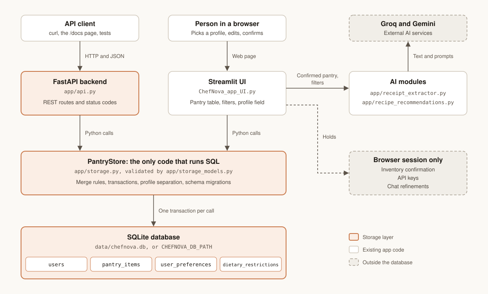

# ChefNova — Architecture & Dataflow

## System diagram



The end-to-end recipe and receipt flows are shown in the dataflow below.

---

## Component descriptions

### Streamlit UI · `ChefNova_app_UI.py`
Entry point for the user. Manages session state (pantry items, dietary profile, preferences) and renders four main panels: receipt upload, pantry manager, dietary profile editor, and recipe cards. The UI reads and writes the pantry directly through `PantryStore` — it does not call the FastAPI server — because the app is deployed on Streamlit Community Cloud, which runs as a single process.

### `receipt_extractor.py`
Runs Tesseract OCR locally and filters receipt text before asking Groq or Gemini to extract grocery items. ChefNova checks that the extracted names have support in the filtered receipt before showing a draft for review.

### `receipt_validator.py`
Flags extracted items for review based on checks such as confidence and quantity. The extraction pipeline validates provider output against the Pydantic schema.

### `schemas.py`
Single source of truth for Pydantic models: `GroceryItem`, `ReceiptExtraction`. Shared by the extractor, validator, and test suite.

### `recipe_recommendations.py`
Builds the recipe prompt from the confirmed pantry and selected constraints. Groq generates candidates, with Gemini as fallback. Python parses the response, applies diet, time, and avoid filters, and ranks surviving candidates by the selected priority. Ranking makes zero provider calls.

### `storage.py` — PantryStore
The only code that talks to the SQLite database. Encapsulates all SQL: reads, writes, merge rules, transactions, and schema migrations. Both the UI and the API import `PantryStore` and use the same database file, so they always see each other's writes.

### `api.py` — FastAPI (optional)
Exposes the pantry and preferences over HTTP for external clients. Maps routes to `PantryStore` calls and store errors to HTTP status codes. Not required to run the Streamlit UI.

### `app/prompts/`
Version-controlled notes on the prompts and response contracts. The recipe runtime prompt and schemas are defined in `app/recipe_recommendations.py`.

---

## Storage layer

```
Persistence · SQLite (data/chefnova.db)
│
├── users                  — one row per profile (names stored lowercase)
├── pantry_items           — one row per ingredient + unit
├── user_preferences       — one row per profile: diet, cuisine, time limit,
│                            ranking priority, high-protein flag
└── dietary_restrictions   — one row per ingredient to avoid (hard filters)
```

Set `CHEFNOVA_DB_PATH` in `.env` to change the database location. The default path is git-ignored because it holds personal data.

---

## Dataflow

```
Receipt Image (PNG/JPG)
      │
      ▼
Tesseract OCR ──► raw text
      │
      ▼
Local receipt filtering ──► Groq or Gemini ──► structured grocery draft
      │
      ▼
Schema and receipt evidence checks ──► user review and approval
      │
      ▼
PantryStore (SQLite) ◄──► Streamlit session state
      │
      ▼
recipe_recommendations.py
  ├──► Groq API (recipe_recommendations prompt)  [primary]
  └──► Gemini Flash-Lite                          [generation fallback]
      │
      ▼
Local Python validation, filtering, and ranking
      │
      ▼
Ranked recipe cards (UI)
```

---

## Technology stack

| Layer | Technology |
|-------|-----------|
| UI | Streamlit |
| OCR | Tesseract 5.x + pytesseract |
| Data validation | Pydantic v2 |
| Primary LLM for recipes | Groq with `openai/gpt-oss-120b` by default |
| Fallback LLM for recipes | Gemini `gemini-3.5-flash-lite` |
| Recipe ranking | Local Python `rank_recipes()` |
| Storage | SQLite via PantryStore |
| REST API (optional) | FastAPI |
| Language | Python 3.11+ |
| Testing | pytest |

## Deployment

The app runs locally or on Streamlit Community Cloud. No external database is required — SQLite runs in-process. For external clients, start the FastAPI server separately alongside the Streamlit app.
