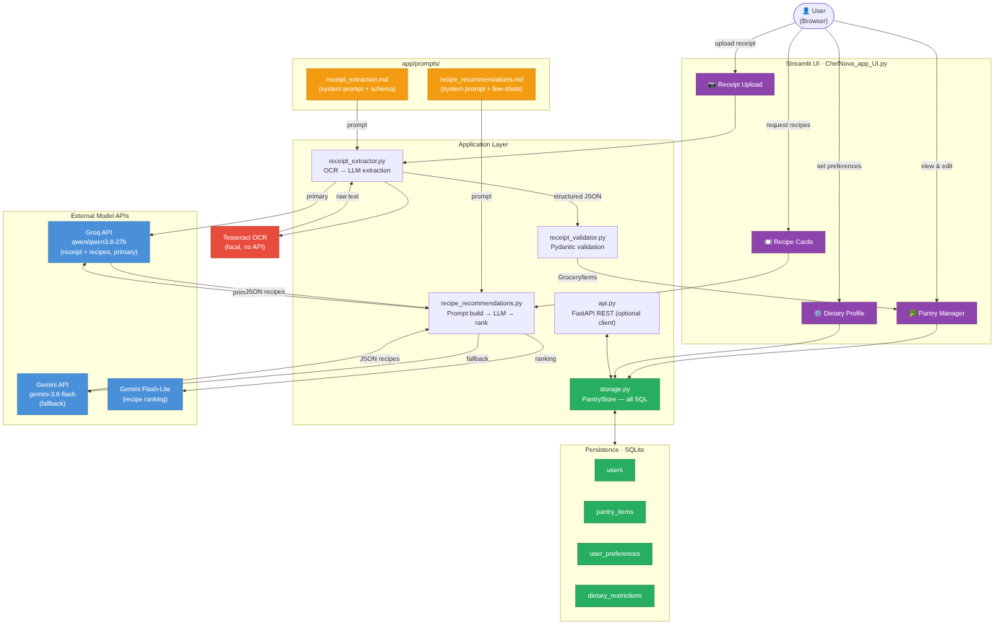

# ChefNova — Architecture & Dataflow

## System diagram



---

## Component descriptions

### Streamlit UI · `ChefNova_app_UI.py`
Entry point for the user. Manages session state (pantry items, dietary profile, preferences) and renders four main panels: receipt upload, pantry manager, dietary profile editor, and recipe cards. The UI reads and writes the pantry directly through `PantryStore` — it does not call the FastAPI server — because the app is deployed on Streamlit Community Cloud, which runs as a single process.

### `receipt_extractor.py`
Runs Tesseract OCR on the uploaded receipt image to produce raw text, then sends that text to the Groq API using the system prompt in `app/prompts/receipt_extraction.md`. Returns structured JSON.

### `receipt_validator.py`
Validates the extracted JSON against the `ReceiptExtraction` Pydantic schema. Items that fail schema validation or fall below the confidence threshold are dropped with a UI warning.

### `schemas.py`
Single source of truth for Pydantic models: `GroceryItem`, `ReceiptExtraction`. Shared by the extractor, validator, and test suite.

### `recipe_recommendations.py`
Builds the recipe prompt from current pantry state and user constraints, calls Groq (primary) with Gemini as fallback, then uses Gemini Flash-Lite to rank results. Parses and returns a ranked list of recipe objects.

### `storage.py` — PantryStore
The only code that talks to the SQLite database. Encapsulates all SQL: reads, writes, merge rules, transactions, and schema migrations. Both the UI and the API import `PantryStore` and use the same database file, so they always see each other's writes.

### `api.py` — FastAPI (optional)
Exposes the pantry and preferences over HTTP for external clients. Maps routes to `PantryStore` calls and store errors to HTTP status codes. Not required to run the Streamlit UI.

### `app/prompts/`
Version-controlled prompt files. Each file documents the system message, model parameters, output schema, and few-shot examples for one pipeline step.

---

## Storage layer

```
Persistence · SQLite (data/chefnova.db)
│
├── users                  — one row per profile (names stored lowercase)
├── pantry_items           — one row per ingredient + unit
├── user_preferences       — one row per profile: diet, cuisine, time limit,
│                            ranking priority, high-protein flag
└── dietary_restrictions   — one row per ingredient to avoid (hard filters)
```

Set `CHEFNOVA_DB_PATH` in `.env` to change the database location. The default path is git-ignored because it holds personal data.

---

## Dataflow

```
Receipt Image (PNG/JPG)
      │
      ▼
Tesseract OCR ──► raw text
      │
      ▼
receipt_extractor.py ──► Groq API (receipt_extraction prompt) ──► JSON
      │
      ▼
receipt_validator.py ──► Pydantic validation
      │
      ▼
PantryStore (SQLite) ◄──► Streamlit session state
      │
      ▼
recipe_recommendations.py
  ├──► Groq API (recipe_recommendations prompt)  [primary]
  ├──► Gemini API                                 [fallback]
  └──► Gemini Flash-Lite                          [ranking]
      │
      ▼
Ranked recipe cards (UI)
```

---

## Technology stack

| Layer | Technology |
|-------|-----------|
| UI | Streamlit |
| OCR | Tesseract 5.x + pytesseract |
| Data validation | Pydantic v2 |
| Primary LLM (receipts + recipes) | Groq — qwen/qwen3.8-27b |
| Fallback LLM | Google Gemini — gemini-3.8-flash |
| Recipe ranking | Gemini Flash-Lite |
| Storage | SQLite via PantryStore |
| REST API (optional) | FastAPI |
| Language | Python 3.11+ |
| Testing | pytest |

## Deployment

The app runs locally or on Streamlit Community Cloud. No external database is required — SQLite runs in-process. For external clients, start the FastAPI server separately alongside the Streamlit app.
