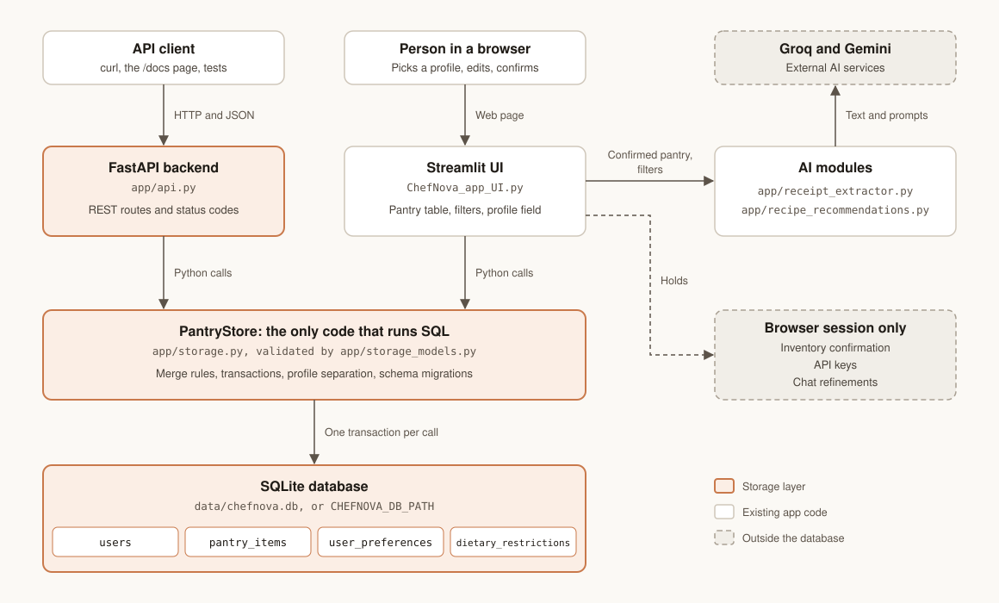
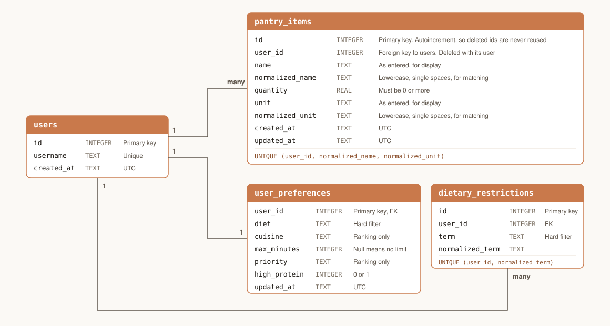

# ChefNova storage architecture

How ChefNova saves pantries and preferences, and how the rest of the app reaches them.

## System



The UI and the API do not call each other. Both import `PantryStore` from [`app/storage.py`](../app/storage.py) and use the same database file, so they apply the same rules and see each other's writes.

The UI skips HTTP because the app is deployed on Streamlit Community Cloud, which runs one process. Requiring a second API server would break that deployment. The API exists for other clients and runs only when started.

| Part | File | Job |
| --- | --- | --- |
| Models | [`app/storage_models.py`](../app/storage_models.py) | Validates data. Holds the allowed diet, cuisine, time, and priority values, which the UI's select boxes also use. |
| Store | [`app/storage.py`](../app/storage.py) | Runs all SQL. Applies merge rules, transactions, and schema migrations. |
| API | [`app/api.py`](../app/api.py) | Maps HTTP routes to store calls, and store errors to status codes. |
| UI | [`ChefNova_app_UI.py`](../ChefNova_app_UI.py) | Reads the pantry from the store on every run and writes through it on every save. |

## Database



The database is one SQLite file, at `data/chefnova.db` by default. Set `CHEFNOVA_DB_PATH` to move it. Git ignores the default file, because it holds personal data.

- **`users`** holds one row per profile. Names are stored in lowercase, so `Aditya` and `aditya` are the same profile.
- **`pantry_items`** holds one row per ingredient and unit.
- **`user_preferences`** holds one row per profile: diet, cuisine, time limit, ranking priority, and high protein. It is created with the profile, so it always exists.
- **`dietary_restrictions`** holds one row per ingredient to avoid. All of them are hard filters.

Deleting a user deletes everything that user owns. The `UNIQUE` constraint on `pantry_items` also serves as the index for listing a pantry, so no separate index is needed.

## Rules

| Rule | Reason |
| --- | --- |
| The same name and unit add together. A different unit stays on its own row. Matching ignores case and extra spaces. | This is the merge rule ChefNova already documented. It avoids guessing at unit conversions. |
| An API edit that would make two identical rows returns 409. Saving the UI's pantry table adds such rows together. | A single-item edit cannot tell which row the user meant to keep. In a whole-table save, the user's intent is visible. |
| Starter rows are added only when a profile is created. | A user who deletes every item must not get the starter rows back. |
| **Confirmation is never saved.** Each new session starts at Needs review, and any pantry change clears the confirmation. | A saved pantry records what was there last time, not what remains today. This keeps the rule that recommendations use current, user-confirmed quantities. |
| Chat refinements are never saved. | "Make it faster" changes the current list. It is not a lasting preference. |
| API keys are never saved. | The UI promises this, and a test checks the database files for the key. |
| A write that touches several rows either fully saves or changes nothing. | A failed save must not leave half a receipt in the pantry. |

## API

Start the server, then open <http://127.0.0.1:8000/docs> to try each route:

```bash
uvicorn app.api:app --reload
```

All routes are under `/api/v1/users/{username}`, except `/health`.

| Method and path | Action | Success |
| --- | --- | --- |
| `GET /health` | Check that the database opens | 200 |
| `PUT /api/v1/users/{username}` | Create the profile, or return it if it exists | 201 or 200 |
| `GET /api/v1/users/{username}` | Read the profile | 200 |
| `DELETE /api/v1/users/{username}` | Erase the profile and all its data | 204 |
| `GET .../pantry` | List items, sorted by name | 200 |
| `POST .../pantry` | Add an item. Returns 200 if it merged into an existing row. | 201 or 200 |
| `PUT .../pantry` | Make the pantry match a list exactly. An empty list clears it. | 200 |
| `GET .../pantry/{item_id}` | Read one item | 200 |
| `PATCH .../pantry/{item_id}` | Change the fields sent | 200 |
| `DELETE .../pantry/{item_id}` | Remove one item | 204 |
| `GET .../preferences` | Read preferences | 200 |
| `PATCH .../preferences` | Change the fields sent. `dietary_restrictions` replaces the whole list. | 200 |

| Error | Meaning |
| --- | --- |
| 404 | No such profile or item. A profile cannot reach another profile's items by id. |
| 409 | The edit would duplicate another row. |
| 422 | The request failed validation. Nothing was saved. |
| 503 | The database cannot be used. Nothing was saved. |

```bash
curl -X PUT http://127.0.0.1:8000/api/v1/users/aditya
curl -X POST http://127.0.0.1:8000/api/v1/users/aditya/pantry \
  -H 'content-type: application/json' \
  -d '{"name": "Rice", "quantity": 2, "unit": "cups"}'
curl -X PATCH http://127.0.0.1:8000/api/v1/users/aditya/preferences \
  -H 'content-type: application/json' \
  -d '{"diet": "Vegan", "cuisine": "Indian", "dietary_restrictions": ["peanuts"]}'
```

Allowed preference values:

| Field | Values |
| --- | --- |
| `diet` | `No preference`, `Vegetarian`, `Vegan` |
| `cuisine` | `Any`, `Indian`, `Mediterranean`, `Asian` |
| `max_minutes` | `15`, `20`, `30`, `45`, or `null` for no limit |
| `priority` | `Best pantry match`, `Fastest`, `Highest protein`, `Fewest missing ingredients` |
| `high_protein` | `true`, `false` |

## Tests

```bash
pip install -r app/requirements.txt
PYTHONPATH=. python3 -m pytest tests -q
```

| File | Covers |
| --- | --- |
| [`tests/test_storage.py`](../tests/test_storage.py) | Constraints, merging, rollback, migrations, concurrent writers, separation between profiles, and data surviving a separate process |
| [`tests/test_api.py`](../tests/test_api.py) | Every route, status code, and validation error |
| [`tests/test_ui_persistence.py`](../tests/test_ui_persistence.py) | The real Streamlit app across sessions, and the UI and API sharing one database |

Every test uses its own temporary database. The run fails if any test writes to the real one.

Streamlit's test runner cannot type into `st.data_editor`, so those tests simulate what the table returns. Typing into the table in a browser is not covered by automated tests.

## Changing the schema

Add a new entry to `MIGRATIONS` in `app/storage.py`. Do not edit an existing entry, because existing databases have already applied it. Each entry runs in one transaction when a store opens the database, and `PRAGMA user_version` records how far it has got. Code that opens a database newer than it understands stops with an error and leaves the file alone.

## Limits

- **Durability depends on where it runs.** Data survives restarts on a machine with a lasting disk, such as a laptop. Streamlit Community Cloud does not guarantee that local files survive a reboot or redeploy, so `chefnova.streamlit.app` can lose saved data. Durable saving there needs a hosted database, which would replace the SQL in `app/storage.py`.
- **There is no login.** A profile name is an identifier, not a password. Anyone using the same deployment can open any profile, and visitors who do not set a name share the `default` profile. Keep the API bound to localhost.
- **Units are not converted.** `lb` and `pounds` are separate rows, and so are `Tomato` and `Tomatoes`.
- **Receipts are not recorded.** Scanning the same receipt twice adds its quantities twice.
- **All dietary restrictions are hard filters.** [Design Spec section 7](../validation/DESIGN_SPEC.md) plans separate tiers for allergies and dislikes. Adding them would take a `tier` column in a new migration, plus UI to set it.
- **One cuisine per profile.** This matches the single-choice select box and the `Constraints.cuisine` field used for ranking.
