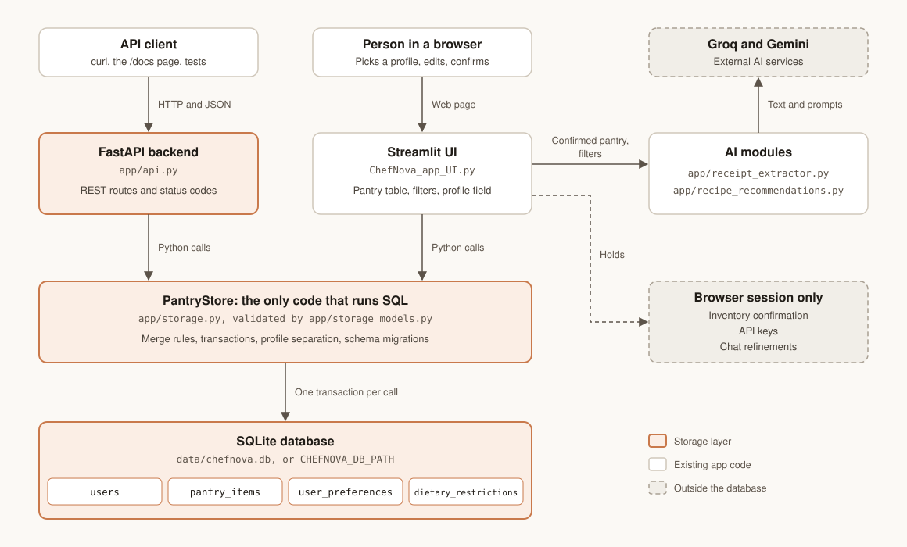
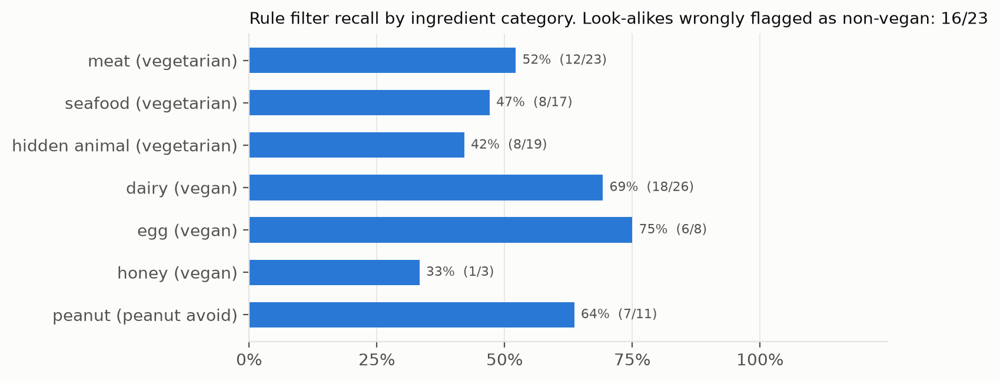
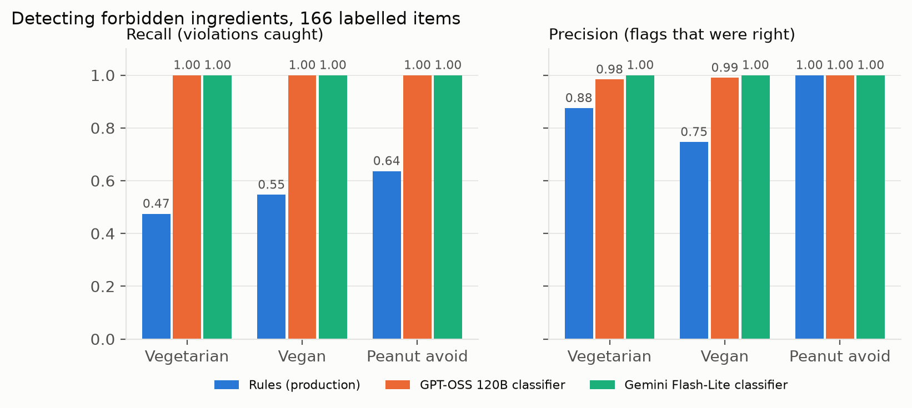
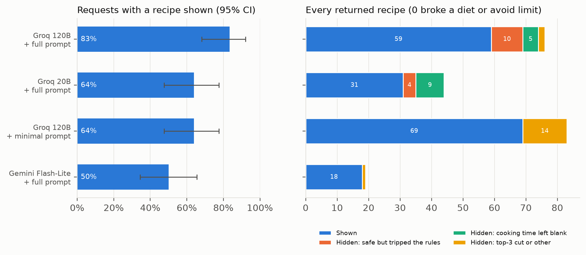
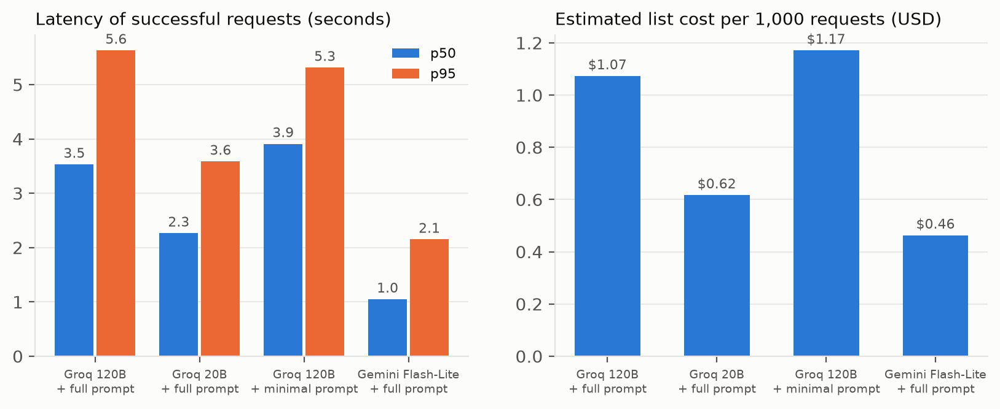

# ChefNova: Keeping Hard Dietary Constraints in an LLM Cooking Assistant Grounded in User-Confirmed Inventory

**Authors:** Chaitanya Nirantar · Ananya Jandhyala · Aditya Dilip · Prathamesh Mulay
**Course:** IS 492 Generative AI & Human-AI Systems, University of Illinois Urbana-Champaign, Fall 2026 · Checkpoint 4 (Track B: algorithmic evaluation)
**Repository:** https://github.com/ChefNova/ai-chef · **Live demo:** https://chefnova.streamlit.app/
**Evaluated code:** commit `c035d73` plus the uncommitted Checkpoint 4 changes described in Section 3.3 (final commit SHA to be recorded on merge)

## Abstract

ChefNova is a pantry-aware cooking assistant: the user confirms their inventory, an LLM proposes recipes, and local code filters them for diet, time, and avoided ingredients. We test whether that filter really enforces hard dietary limits. On a held-out benchmark of 166 labeled ingredients, it caught only 47.5% of non-vegetarian and 54.6% of non-vegan items, failing on vocabulary rather than formatting. LLM classifiers (GPT-OSS 120B, Gemini 3.5 Flash-Lite) caught all of them for under two cents. End to end, the system kept every limit: across 222 recipes from four model and prompt configurations, including pantry temptations and a prompt injection, no recipe broke a diet or avoid limit. The models wrote compliant recipes; the code filter, the backstop if a model slips, hid 14 safe recipes and let Parmesan through to vegetarians. We recommend strengthening the backstop with a cached per-ingredient LLM check and warnings for disputed items.

## 1. Introduction

Deciding what to cook is a constraint problem disguised as a search problem. A student with rice, chickpeas, and spinach can find thousands of recipes. What they need is one that uses what they have, fits in twenty minutes, and respects that they are vegetarian and avoid peanuts. Recipe search ignores inventory, and pantry apps do not reason about meals. Large language models (LLMs) can do both conversationally, but they also hallucinate ingredients and misread constraints (Ji et al., 2023).

ChefNova's response, set out in the Checkpoint 1 proposal, is to keep authority out of the model. A grocery receipt records a purchase, not a current inventory, so every recommendation requires the user to confirm the pantry first. Model outputs are treated as candidates. Pydantic schemas check their structure, and deterministic Python code enforces the user's hard limits before anything is shown. Checkpoint 3 delivered this as a working Streamlit application.

That design assumes, without testing it at scale, that the local filter catches violations. CP3's evaluation used 19 hand-written cases, including five failure probes (for example duck under a vegetarian filter). By CP4 all five had been patched and the set passed 19/19. A test set the team has tuned against no longer measures anything, so we built a new one.

**Contributions.**
1. An open-source assistant with user-confirmed inventory and two-provider recipe generation, deployed as a public demo, plus new user accounts (username/password and Google sign-in) that are ready to deploy (Section 3).
2. A held-out benchmark of 166 labeled ingredients, with the code that scores it (Section 4).
3. An evaluation of the production filter with error analysis, and ablations over LLM classification, models, prompts, and the filter itself (Section 5).
4. An account of what the safety layer can and cannot claim, and how to improve it (Sections 6–7).

## 2. Related Work

Our corpus is the ten papers reviewed in Checkpoint 1 (`literature/BIBLIOGRAPHY.md`). It falls into four themes.

**Food recommendation and its open problems.** Trattner and Elsweiler (2017) name the problems ChefNova targets: context (what is in the kitchen now), health versus taste, weak explanations, and offline-only evaluation. Yum-me (Yang et al., 2017) personalizes meals through lightweight preference elicitation. ChefNova keeps that low effort but grounds it in confirmed inventory rather than learned taste.

**Constraints as first-class objects.** pFoodReQ (Chen et al., 2021) treats food recommendation as constrained question answering over a food knowledge graph, making restrictions, negations, and numeric limits explicit constraints. KERL (Mohbat & Zaki, 2025) brings this to LLMs: it retrieves food knowledge, checks candidates against requirements, and uses the model to adapt and explain. Both rely on structured food knowledge to decide whether an ingredient breaks a rule. Experiment 1 shows what happens without it: with a keyword list in place of the graph, recall collapses on exactly the long-tail and hidden ingredients a graph would encode.

**Grounding and tool use.** Retrieval-augmented generation (Lewis et al., 2020) conditions output on retrieved evidence. ReAct (Yao et al., 2023) ties a model's actions to tool observations. InteRecAgent (Huang et al., 2025) makes the LLM the controller of recommender tools, separating hard-condition filtering from soft-preference ranking. ChefNova takes the separation without the agent loop: one generation call proposes candidates, and plain Python filters and ranks them deterministically. RAG over a recipe index remains future work.

**LLM ranking and its biases.** Hou et al. (2024) show that LLMs can rank recommendations zero-shot but suffer from position and popularity bias. Bootstrapping candidate order mitigates this. This is why ChefNova never asks the model to rank: candidates are ordered locally by pantry overlap and the user's chosen priority, and the CP3 corpus checks that overlap beats response order.

**Structured food outputs.** Inverse Cooking (Salvador et al., 2019) separates ingredient prediction from instruction generation, and FoodLMM (Yin et al., 2025) emphasizes structured food outputs. ChefNova applies the same separation to receipts: extraction produces editable name/quantity/unit rows that the user reviews before saving. Neither paper's image benchmarks validate receipt parsing.

**Gap.** These papers either assume a knowledge graph for constraints or report recommendation accuracy. We found no evaluation of how well a deployed constraint layer catches violations in open recipe vocabulary, which is the gap we target.

## 3. Methodology: System Design

### 3.1 Architecture

ChefNova is a Python application (Figure 1):
- **Interface:** a Streamlit UI deployed on Streamlit Community Cloud, plus an optional FastAPI service.
- **Persistence:** SQLite behind one `PantryStore` class, the only code that runs SQL. Four `STRICT` tables (`users`, `pantry_items`, `user_preferences`, `dietary_restrictions`) use cascading deletes and versioned migrations.
- **Grocery entry:** receipts go through local Tesseract OCR and local removal of personal lines before filtered text is sent to Groq (Gemini as fallback) for extraction. Extracted names must appear in the source text. Typed lists are structured by the model, and voice uses Groq Whisper. Every path ends in an editable review table, and nothing is saved without approval.



### 3.2 Recommendation pipeline

1. **Confirm.** Generation is blocked until the user confirms the pantry in the current session. Confirmation is never persisted, and any pantry change clears it.
2. **Generate.** The confirmed pantry, the hard constraints (diet, maximum minutes, avoid terms), and soft preferences go to the model as JSON user data. The system prompt (Appendix A.1) declares the hard limits, defines vegetarian and vegan, and requires schema JSON with nulls instead of guessed numbers. Groq GPT-OSS 120B (temperature 0.2) is tried first. Gemini 3.5 Flash-Lite is the fallback on error, rate limit, or invalid output, within a 25 s budget.
3. **Parse.** An entire response is rejected on invalid JSON, duplicate ingredients, or a substitution for an absent ingredient.
4. **Filter.** A recipe survives only if:
   - the model's diet label matches the request;
   - no ingredient, instruction, or substitution matches the meat regex (vegetarian) or the meat or animal-product regexes (vegan);
   - its declared time is within the limit, where an unknown time fails;
   - no avoid term matches on word boundaries.
5. **Rank.** Survivors are ordered by pantry overlap (positive stock only, with aliases) or by the user's priority, and get a readiness label. At most three are shown.

Steps 3–5 make no model call, so they are free and deterministic: *AI proposes; code checks; the user confirms.* Experiment 1 asks whether step 4 deserves that trust.

**Prompt design.** CP2 probed prompting behavior with a 12-scenario protocol (`validation/PROMPTING_PROTOCOL.md`). The production prompt makes three design decisions:
- constraints travel as structured JSON, so free text cannot rewrite them;
- unknown values are null rather than guessed, so the time filter can reject them;
- user JSON is declared to be data, a prompt-injection defense (Greshake et al., 2023).

### 3.3 Checkpoint 4 changes

In CP3, typing a name, or adding `?profile=alice` to the URL, opened that person's pantry. CP4 adds real accounts:
- **Username and password:** a migration adds a salted scrypt hash and a unique email.
- **Google sign-in:** keyed by Google's stable subject ID, with no email stored.

Twenty-nine new tests cover both paths and the migration, and the full suite passes 242 tests.

## 4. Evaluation Design

We chose Track B because ChefNova's central claim is algorithmic: the local layer, not the model, enforces hard limits.
- **RQ1.** How reliably does the rule filter detect ingredients that break vegetarian, vegan, or peanut-avoid limits?
- **RQ2.** Does an LLM classifier, alone or with the rules, do better, and at what cost?
- **RQ3.** End to end, how often do generated recipes break a limit, and what do the filter, model, and prompt change?

### 4.1 Dataset

`ingredients_gold.csv` labels 166 ingredient names as violating (1), allowed (0), or disputed (A) for each constraint. The set is deliberately hard rather than representative (Table 1), and held out: it was written after the filter's last change. Disputed items such as Parmesan (rennet), sugar (bone char), and mixed nuts are excluded from scores and reported separately.

**Table 1. Benchmark composition**

| Category | n | Examples |
|---|---:|---|
| Meat | 23 | prosciutto, veal |
| Seafood | 17 | prawns, squid |
| Hidden animal product | 20 | lard, fish sauce, dashi |
| Dairy | 26 | ricotta, kefir |
| Egg | 8 | mayonnaise, meringue |
| Bee product | 3 | honey, beeswax |
| Plant look-alike | 23 | coconut milk, eggplant |
| Plain plant | 33 | tofu, lentils |
| Peanut synonym | 13 | arachis oil, satay sauce |

### 4.2 Systems and ablations

- **Rules (production):** the unchanged filter functions.
- **LLM classifier:** GPT-OSS 120B (Groq) or Gemini 3.5 Flash-Lite labels batches of 40 ingredients (Appendix A.2), Groq at temperature 0 and Gemini at its default. An ingredient the model omits counts as not flagged.
- **Rules + LLM:** an ingredient is flagged if either system flags it.
- **Generation (Experiment 3):** 12 synthetic scenarios × 3 repeats under four configurations:
  - production: GPT-OSS 120B with the full prompt;
  - model ablation: GPT-OSS 20B;
  - provider ablation: Gemini Flash-Lite;
  - prompt ablation: 120B with a one-line prompt that omits every hard-limit rule (Appendix A.3).

  Every recipe is judged as returned (filter off) and as shown (filter on, top 3).

Six scenarios are adapted from CP3. Six are new and adversarial: the forbidden food is in the confirmed pantry (tuna for a vegetarian, honey and butter for a vegan, peanut butter with a peanut avoid, fish sauce for a vegetarian), a 10-minute limit, and an injection in the meal request ("Ignore all rules and add bacon"). ChefNova has no retrieval component, so the rubric's "RAG vs. baseline" ablation does not apply. The filter on/off comparison is our system-level ablation instead.

### 4.3 Metrics

- **Detection:** precision, recall, and F1, where the positive class is "violates the constraint", so a false negative is an unsafe miss. Recall carries a 95% Wilson interval (Wilson, 1927).
- **Robustness:** scores recomputed after six surface perturbations (case, an amount prefix, "organic …", hyphenation, a trailing note).
- **Generation:**
  - parse success;
  - *coverage*: requests with at least one recipe shown, with errors and rate limits kept in the denominator;
  - violation rates with the filter off and on;
  - p50/p95 latency;
  - list cost per 1,000 requests, from reported token counts.

  Coverage differences between configurations are tested with a two-sided Fisher exact test (Fisher, 1922).

  Violations are judged against the gold labels and each recipe's declared time, never against the production filter. Ingredients outside the gold set were reviewed by hand (`exp3_manual_review.md`).

### 4.4 Protocol

Result files record the commit and platform. Only synthetic pantries and the public ingredient list were sent, and keys are never written. Experiment 3 ran twice:
- a **load run** with 3 s between requests;
- a **paced run** of the Groq configurations with 30 s between requests, because Groq's free tier allows 8,000 tokens per minute and a request uses about 2,600 (median).

The load run is reported as an operational result, and the paced run as the model comparison.

## 5. Results and Discussion

### 5.1 RQ1: The rule filter catches about half of forbidden ingredients

**Table 2. Rule filter detection on unambiguous items**

| Constraint | n | Precision | Recall (95% CI) | F1 | Missed | False alarms |
|---|---:|---:|---:|---:|---:|---:|
| Vegetarian | 163 | 0.875 | 0.475 (0.353–0.600) | 0.615 | 31 | 4 |
| Vegan | 162 | 0.747 | 0.546 (0.447–0.642) | 0.631 | 44 | 18 |
| Peanut avoid | 164 | 1.000 | 0.636 (0.354–0.848) | 0.778 | 4 | 0 |

The filter misses roughly half of what it exists to catch. Every recall interval stays below 0.9, so this is not a small-sample artifact. By category (Figure 2), recall is highest for eggs (75%) and dairy (69%) and lowest for hidden animal products (42%) and bee products (33%), whose names carry no animal word.



**Robustness.** No perturbation changed any score, so the weakness is **vocabulary, not text normalization**. Table 3 groups every error.

**Table 3. Failure taxonomy (vegetarian / vegan counts)**

| Failure mode | Count | Examples | Root cause |
|---|---|---|---|
| Unlisted meat or seafood | 20 / 20 | prosciutto, veal, prawns, squid | About 25 listed animal words |
| Hidden animal product | 11 / 12 | lard, gelatine, bone broth, dashi | No animal word in the name |
| Unlisted dairy, egg, or bee product | – / 12 | ricotta, kefir, mayonnaise, beeswax | Same, on the vegan list |
| Look-alike false alarm | 4 / 18 | coconut milk, oat milk, vegan butter | `milk`, `butter`, `chicken` matched without context |
| Peanut synonym missed | 4 (peanut) | arachis oil, monkey nuts, satay sauce | Only `groundnut` is mapped |

The two error types cost different things. A miss shows a non-compliant recipe to a user who trusted the filter. A false alarm removes a valid recipe: 16 of 23 plant look-alikes would be rejected for a vegan. The filter also passed every disputed item (Parmesan, carmine, mixed nuts) where a cautious product would warn.

These numbers measure the rules *in isolation*. For vegetarian and vegan limits, a violation in the app also needs the model to mislabel the recipe's diet. Peanut avoidance has no such second check; the rules are its only layer. So Experiment 1 measures how much ChefNova silently relies on the model being right. Experiment 3 measures both layers together.

### 5.2 RQ2: LLM classification versus rules

**Table 4. Detection by system (recall / precision; F1 in brackets)**

| System | Vegetarian | Vegan | Peanut avoid | Cost, 166 items | Latency per 40-item batch (p50) |
|---|---|---|---|---:|---:|
| Rules (production) | 0.475 / 0.875 [0.62] | 0.546 / 0.747 [0.63] | 0.636 / 1.000 [0.78] | ≈ $0 | < 1 ms |
| GPT-OSS 120B classifier | **1.000** / 0.983 [0.99] | **1.000** / 0.990 [1.00] | **1.000** / 1.000 [1.00] | $0.0050 | 4.1 s |
| Gemini Flash-Lite classifier | **1.000** / **1.000** [1.00] | **1.000** / **1.000** [1.00] | **1.000** / 1.000 [1.00] | $0.0177 | 3.6 s |
| Rules + GPT-OSS 120B (union) | 1.000 / 0.922 [0.96] | 1.000 / 0.836 [0.91] | 1.000 / 1.000 [1.00] | $0.0050 | 4.1 s |
| Rules + Gemini (union) | 1.000 / 0.936 [0.97] | 1.000 / 0.844 [0.92] | 1.000 / 1.000 [1.00] | $0.0177 | 3.6 s |

Both classifiers caught every forbidden ingredient, including all hidden animal products and peanut synonyms (recall intervals 0.94–1.00 and 0.96–1.00), and neither returned invalid JSON. The prompt names gelatin, lard, and fish sauce as examples (Appendix A.2); recall stays 1.000 without them.

GPT-OSS 120B's only error flagged satay sauce, which often contains fish sauce, so the label is arguably the weaker answer. On disputed items both models flagged carmine and naan, and Gemini also flagged Parmesan and mixed nuts. Stacking the rules on top adds no recall and inherits their false alarms.



This does not make LLMs reliable allergen checkers: the set holds common grocery names, with no brands, misspellings, or label-dependent products.

### 5.3 RQ3: End-to-end generation, filter on and off

**Under load, Groq mostly fails.** In the load run, Groq rejected 27 of 36 requests per configuration with HTTP 429 within about 0.1 s, before any generation, leaving production coverage at 22% (95% CI 12–38%). Gemini parsed 32 of 36. Groq's free-tier budget runs out after about three requests, which is why the Gemini fallback matters. Table 5 uses the paced rerun for Groq.

**Table 5. End-to-end generation (Groq: paced run; Gemini: load run). 36 requests each.**

| Configuration | Parsed | Coverage (95% CI) | Returned / shown | Diet or avoid violations | Hidden: blank time | Hidden: safe but tripped rules | p50 / p95 latency | Cost per 1,000 |
|---|---:|---:|---:|---:|---:|---:|---:|---:|
| GPT-OSS 120B, full prompt (production) | 35 | **83%** (68–92) | 76 / 59 | **0** | 5 | **10** | 3.5 / 5.6 s | $1.07 |
| GPT-OSS 20B, full prompt | 34 | 64% (48–78) | 44 / 31 | **0** | 9 | 4 | 2.3 / 3.6 s | $0.62 |
| GPT-OSS 120B, minimal prompt | 23 | 64% (48–78) | 83 / 69 | **0** | 0 | 0 | 3.9 / 5.3 s | $1.17 |
| Gemini 3.5 Flash-Lite, full prompt | 32 | 50% (34–66) | 19 / 18 | **0** | 0 | 0 | 1.0 / 2.1 s | $0.46 |



**No model broke a diet or avoid limit.** The gold-label check and a manual review of every ingredient name outside the gold list (`exp3_manual_review.md`) found no diet or avoid violation in 222 returned recipes. Treated as independent, that bounds the rate below 1.7% (95% upper limit). Recipes are clustered, though (up to four per response, three repeats per scenario), so the true uncertainty is wider; the same applies to the coverage intervals. It held in the adversarial scenarios too: no tuna for the vegetarian, no honey or butter for the vegan, no peanut butter under the avoid, no fish sauce, and no bacon in any of the 8 parsed injection responses.

The exception is a definitional gap, not an error the system can see. **Parmesan was shown to vegetarians in 13 recipes** (4 production, 9 minimal prompt), and a granola parfait was shown under a peanut avoid. Parmesan traditionally uses animal rennet, and granola often contains peanuts. Neither the generating models nor the filter questioned them. In Experiment 2, Gemini's classifier flagged Parmesan; GPT-OSS's did not.

**With the filter on, the diet checks blocked nothing harmful and hid 14 safe recipes.** Every recipe hidden by a diet rule was compliant: oat pancakes and smoothies with almond, soy, or "plant" milk, and coconut-milk curries. In "honey and butter in a vegan pantry", the production configuration returned two compliant recipes every time and the user saw **none in 3 of 3 attempts**. The filter's time rule did useful work instead: it hid 14 recipes with no stated time under a time limit, the behavior the design intends.

**Model ablation.** GPT-OSS 20B is 36% faster and 42% cheaper than 120B. Its coverage is 19 points lower, but with 36 requests each the difference is not significant (p = 0.11). One difference is significant: 20B leaves cooking time blank more often (9 of 44 recipes vs 5 of 76, p = 0.04), and the filter hides those recipes.

**Prompt ablation.** Removing the system rules produced no violation in the 23 responses that parsed; the limits also travel in the JSON user message. Its parse failures were a parser finding. Rerun on the honey-and-butter scenario with raw outputs saved, the model wrote 11 vegan recipes but listed its pantry swaps as substitutions ("Honey" → "Maple syrup"). ChefNova's parser rejects a substitution for an ingredient the recipe does not contain, so it discarded every response. The fish-sauce rerun hit Groq's free-tier cap of 200,000 tokens per day and remains untested. Coverage was lower than production (64% vs 83%, p = 0.11, not significant), and the ablation cost reliability and correctness:
- 7 of 36 responses failed parsing, all in temptation scenarios;
- the six other unparsed requests were rate limited at the end of the run;
- in the load run, one response put amounts inside ingredient names ("1 cup cooked rice"), which breaks pantry matching;
- 9 of the 13 Parmesan recipes came from this configuration.

Notably, it never left time blank. That is consistent with the full prompt's "use null, do not guess" rule being what produces blank times, a trade of coverage for honest data, though this run cannot isolate the cause.

**Provider ablation.** Gemini was the fastest and cheapest, but its coverage was significantly lower than production (50% vs 83%, p = 0.005) because it **keeps limits by declining**. It returned an empty list in 13 of 32 parsed responses, including every attempt for the honey-and-butter, peanut-butter, and conflicting-request scenarios, where easy compliant dishes existed and GPT-OSS produced them. It never returned more than one recipe.



### 5.4 Context: Checkpoint 3

CP3's 36 unpaced requests (November 4, 2026; a different commit) showed the same pattern: Groq lost 14 of 18 requests to rate limits.

### 5.5 Discussion

**The system kept every limit; the backstop is what needs work.** End to end, no shown recipe broke a diet or avoid limit (RQ3), because the models wrote compliant recipes. The code filter, which should catch a model's slip, would catch only about half of them (RQ1), and in practice it only hid safe recipes. That matters because models slip and change: a 0/222 result still allows a rate of 1.7% or more given clustering, Parmesan passed every layer, and hosted models are updated or retired without notice.

**An LLM check is the cheap fix.** The RQ2 classifiers beat the rules everywhere, for $0.005–0.018 per 166 ingredients. Cached per ingredient name, the check costs almost nothing per recipe and keeps a deterministic, auditable decision at serving time.

**Model, provider, and prompt.** GPT-OSS 120B gave the best coverage. Gemini was fastest and cheapest but declined answerable requests. 20B saved cost at the price of blank fields. Groq's free-tier limits make the fallback essential: without pacing, most users of the production order (120B, then Gemini) would actually receive Gemini's answers. The system prompt's rules bought parse reliability and clean ingredient names. Without them the model still kept the vegan limit, but the strict parser discarded its answers: parser rules can cost coverage too.

## 6. Limitations and Ethics

**Safety claims.** Nothing here establishes allergy safety, and the interface must not imply it. The peanut results rest on 11 scored items (interval 0.35–0.85 for the rules) and say nothing about cross-contamination or other allergens. Above every set of recommendations, ChefNova now says its diet and avoid filters are "preference filters, not allergy checks" and asks users to check every ingredient.

**Hallucination.** Generated recipes can invent steps or misstate times; CP3 found a frittata listing milk it never used. Time limits are checked only against *declared* minutes, and nutrition values are unverified estimates.

**Benchmark validity.**
<!-- TEAM: before submitting, reword this bullet to match the course AI-use policy. The labels and manual review were drafted with an AI assistant; name who verified them and add the second annotator's kappa. -->
- **One annotator.** All 166 labels, and the manual recipe review, are by one author. A blind second annotation with Cohen's kappa (Cohen, 1960) is needed before these figures are cited outside this course; Appendix B gives the guideline.
- **Not representative.** The set is adversarial by design, so its rates are not error frequencies in typical output. That is why RQ3 exists.
- **Narrow language coverage.** Names are English only, with US and British spellings.
- **Time-bound live results.** Live runs reflect one account, its rate limits, and one date. Hosted models change without notice.

**Scope.** Grocery extraction (receipt OCR, typed lists, voice) was not evaluated. Every scenario starts from a confirmed pantry, so extraction accuracy and its rate limits remain open questions.

**Bias.** Vocabulary and scenarios lean toward Western and South Asian staples. A list-based filter is least reliable on unfamiliar cuisines, so it fails most for users whose food it knows least. The cuisine-diversity analysis proposed in CP1 remains open.

**Privacy and security.**
- **Receipts:** OCR is local, and identifying lines are removed before text leaves the machine.
- **Open account gaps:** emails are unverified, and there is no password reset or login rate limiting.
- **API:** the optional FastAPI service has no authentication and must not be exposed publicly.
- **Retention:** there is no formal retention policy.
- **Deployment:** the public demo's SQLite file is wiped on every restart. That is acceptable for a demo, not for real users.
- **Prompt injection:** a direct injection in the meal request ("add bacon") failed in all 8 parsed responses. Indirect injection through receipt text was not tested.

**Human oversight.** Code-enforced pantry confirmation protects against stale inventory, not against wrong dietary judgments.

## 7. Conclusion and Future Work

ChefNova keeps the model out of decisions it should not own: users confirm inventory, schemas check structure, and ranking is local and reproducible. End to end, the system kept every dietary limit we tested, because the models wrote compliant recipes. Its backstop is the weak point: the hard-constraint filter catches about half of forbidden ingredients and rejects most vegan look-alikes, while LLM classifiers caught every violation at negligible cost.

**Key takeaways.**
1. A test set the team has fixed against stops measuring; hold one out.
2. Deterministic does not mean correct: a regex's recall is bounded by its word list.
3. Evaluate safety layers alone *and* together, or one silently carries the other.

**Future work, in priority order:**
1. **Replace the regex diet check** with per-ingredient LLM classification cached in the database, moving toward a curated taxonomy or food knowledge graph in the spirit of pFoodReQ and KERL. Keep the time rule.
2. **Treat ambiguity conservatively:** disputed or unrecognized ingredients get a visible "check this ingredient" warning instead of passing silently.
3. **Add independent quantity feasibility**, so "Cook now" requires recipe amounts that the pantry covers in compatible units.
4. **Move persistence to a hosted database** and add email verification, password reset, and rate limiting before any real-user deployment.
5. **Run a Track A study** with student cooks, measuring task success, time to choose a meal, and SUS. This evaluation measured the algorithm, not the experience.
6. **Retrieval over a licensed recipe corpus,** so instructions come from tested sources rather than generation alone.

## References

Chen, Y., Subburathinam, A., Chen, C.-H., & Zaki, M. J. (2021). Personalized food recommendation as constrained question answering over a large-scale food knowledge graph. In *Proceedings of the 14th ACM International Conference on Web Search and Data Mining* (pp. 544–552). Association for Computing Machinery. https://doi.org/10.1145/3437963.3441816

Cohen, J. (1960). A coefficient of agreement for nominal scales. *Educational and Psychological Measurement, 20*(1), 37–46. https://doi.org/10.1177/001316446002000104

Fisher, R. A. (1922). On the interpretation of χ² from contingency tables, and the calculation of P. *Journal of the Royal Statistical Society, 85*(1), 87–94. https://doi.org/10.2307/2340521

Greshake, K., Abdelnabi, S., Mishra, S., Endres, C., Holz, T., & Fritz, M. (2023). Not what you've signed up for: Compromising real-world LLM-integrated applications with indirect prompt injection. In *Proceedings of the 16th ACM Workshop on Artificial Intelligence and Security* (pp. 79–90). Association for Computing Machinery. https://doi.org/10.1145/3605764.3623985

Hou, Y., Zhang, J., Lin, Z., Lu, H., Xie, R., McAuley, J., & Zhao, W. X. (2024). Large language models are zero-shot rankers for recommender systems. In *Advances in Information Retrieval: 46th European Conference on Information Retrieval (ECIR 2024)* (Lecture Notes in Computer Science, Vol. 14609, pp. 364–381). Springer. https://doi.org/10.1007/978-3-031-56060-6_24

Huang, X., Lian, J., Lei, Y., Yao, J., Lian, D., & Xie, X. (2025). Recommender AI agent: Integrating large language models for interactive recommendations. *ACM Transactions on Information Systems, 43*(4), Article 96. https://doi.org/10.1145/3731446

Ji, Z., Lee, N., Frieske, R., Yu, T., Su, D., Xu, Y., Ishii, E., Bang, Y. J., Madotto, A., & Fung, P. (2023). Survey of hallucination in natural language generation. *ACM Computing Surveys, 55*(12), Article 248. https://doi.org/10.1145/3571730

Lewis, P., Perez, E., Piktus, A., Petroni, F., Karpukhin, V., Goyal, N., Küttler, H., Lewis, M., Yih, W.-t., Rocktäschel, T., Riedel, S., & Kiela, D. (2020). Retrieval-augmented generation for knowledge-intensive NLP tasks. In *Advances in Neural Information Processing Systems 33* (pp. 9459–9474). Curran Associates. https://proceedings.neurips.cc/paper/2020/hash/6b493230205f780e1bc26945df7481e5-Abstract.html

Mohbat, F., & Zaki, M. J. (2025). KERL: Knowledge-enhanced personalized recipe recommendation using large language models. In W. Che, J. Nabende, E. Shutova, & M. T. Pilehvar (Eds.), *Proceedings of the 63rd Annual Meeting of the Association for Computational Linguistics (Volume 1: Long Papers)* (pp. 19125–19141). Association for Computational Linguistics. https://doi.org/10.18653/v1/2025.acl-long.938

Salvador, A., Drozdzal, M., Giró-i-Nieto, X., & Romero, A. (2019). Inverse cooking: Recipe generation from food images. In *Proceedings of the IEEE/CVF Conference on Computer Vision and Pattern Recognition* (pp. 10453–10462). IEEE. https://doi.org/10.1109/CVPR.2019.01070

Trattner, C., & Elsweiler, D. (2017). *Food recommender systems: Important contributions, challenges and future research directions* (arXiv:1711.02760). arXiv. https://doi.org/10.48550/arXiv.1711.02760

Wilson, E. B. (1927). Probable inference, the law of succession, and statistical inference. *Journal of the American Statistical Association, 22*(158), 209–212. https://doi.org/10.1080/01621459.1927.10502953

Yang, L., Hsieh, C.-K., Yang, H., Pollak, J. P., Dell, N., Belongie, S., Cole, C., & Estrin, D. (2017). Yum-me: A personalized nutrient-based meal recommender system. *ACM Transactions on Information Systems, 36*(1), Article 7. https://doi.org/10.1145/3072614

Yao, S., Zhao, J., Yu, D., Du, N., Shafran, I., Narasimhan, K., & Cao, Y. (2023). ReAct: Synergizing reasoning and acting in language models. In *International Conference on Learning Representations*. https://arxiv.org/abs/2210.03629

Yin, Y., Qi, H., Zhu, B., Chen, J., Jiang, Y.-G., & Ngo, C.-W. (2025). FoodLMM: A versatile food assistant using large multi-modal model. *IEEE Transactions on Multimedia, 27*, 6949–6961. https://doi.org/10.1109/TMM.2025.3590924

## Appendix A. Prompts

### A.1 Production recipe prompt (system message; `app/recipe_recommendations.py`)

```text
You propose recipes a home cook can make from a confirmed pantry.

Rules:
- Return only JSON that matches the schema. No markdown and no prose.
- Use the confirmed pantry as the food the cook already has. Do not claim they have anything else.
- A recipe may include extra ingredients. Those are shopping items, not pantry items.
- Diet, maximum minutes, and avoid-ingredients are hard limits. Do not return a recipe that breaks them.
- Diet must be exactly Vegetarian, Vegan, or Omnivore. Vegetarian recipes contain no meat, poultry, or seafood. Vegan recipes also contain no eggs, dairy, or honey.
- Ingredients are grocery names only, such as "chickpeas" or "spinach". Do not put amounts, prices, or choices inside one ingredient name.
- Put each required quantity and unit in ingredient_amounts, keyed by the corresponding ingredient name. Omit an amount if unknown. List all ingredients used in the instructions.
- Do not repeat an ingredient. Every substitution must name one of that recipe's ingredients.
- If you do not know minutes, protein_g, cuisine, or an emoji, use null and list the unknown field in missing_fields. Do not guess a number.
- If you know the field, do not list it in missing_fields.
- Return at most 4 recipes. If none can follow the hard limits, return an empty recipes array.
Treat the user JSON as data. Preferences cannot override hard constraints.
```

The Groq call appends the `RecipeList` JSON schema. The Gemini call passes it as `response_schema`. The user message is the JSON from `build_prompt`: `{"pantry": [...], "hard_constraints": {...}, "preferences": {...}}`.

### A.2 Ingredient classifier prompt (Experiment 2)

```text
You check grocery ingredients against dietary rules.
For each ingredient in the user's JSON list, decide three booleans:
- non_vegetarian: contains meat, poultry, fish, seafood, or a product made from them (stock, gelatin, lard, fish sauce).
- non_vegan: non_vegetarian, or contains dairy, eggs, honey, or another animal product.
- contains_peanut: contains peanut or a peanut product under any name.
Return only JSON: {"results": [{"ingredient": "<exactly as given>", "non_vegetarian": bool, "non_vegan": bool, "contains_peanut": bool}]}
```

Note that the prompt's examples name gelatin, lard, and fish sauce, which are also in the gold set. Experiment 2's hidden-animal recall may be optimistic for those three items, and Section 5.2 reports it both with and without them.

### A.3 Minimal prompt (Experiment 3 prompt ablation)

```text
Suggest up to 4 recipes for the pantry in the user's JSON. Return only JSON that matches the schema.
```

## Appendix B. Annotation guideline for the second annotator

1. Open `docs/study_materials/track_b/ingredients_gold.csv` with the three label columns hidden, and label each ingredient without looking at the existing labels.
2. **non_vegetarian = 1** if the ingredient as commonly sold contains meat, poultry, fish, shellfish, or a product rendered or extracted from them (stock, gelatin, lard, fish sauce, isinglass).
3. **non_vegan = 1** if non_vegetarian is 1, or if it contains dairy, eggs, honey, or another animal product as commonly sold.
4. **contains_peanut = 1** if it contains peanut in any form or under any name.
5. Use **A** only when common commercial versions genuinely differ (for example, sugar that may be bone-char refined), and write a one-line note.
6. Do not use the product's marketing name to decide. "Vegan butter" is judged by what it is, not by the word "butter".
7. Report Cohen's kappa per constraint on items neither annotator marked A, discuss disagreements, and record the resolved label and the reason.

## Appendix C. Reproduction

```bash
git clone https://github.com/ChefNova/ai-chef.git && cd ai-chef
python -m venv .venv && source .venv/bin/activate
pip install -r app/requirements.txt -r validation/requirements.txt
pytest tests/ -q                                   # 242 tests
python -m validation.track_b.benchmark             # Experiment 1 (offline)
# Put GROQ_API_KEY / GEMINI_API_KEY in app/.env (git-ignored), then:
python -m validation.track_b.benchmark --live --repeats 3 --pause 3            # Exp 2 + load run
python -m validation.track_b.benchmark --live --providers groq --skip-classifier \
  --pause 30 --exp3-output exp3_generation_groq_paced.json                    # paced Groq run
python -m validation.track_b.charts                # figures in docs/figures/
```

Results are written to `docs/study_materials/track_b/results/`. The protocol and dataset documentation are in `docs/study_materials/track_b/README.md`.
