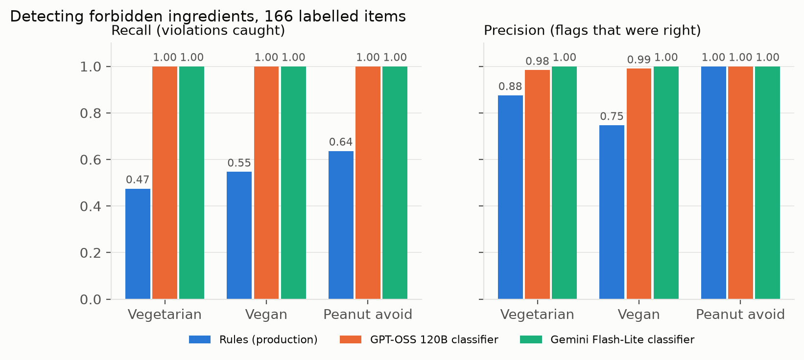
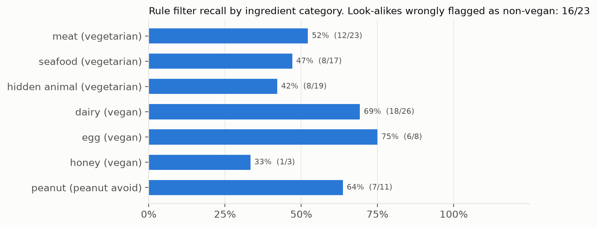

# Track B evaluation: does ChefNova keep users' hard constraints?

Status, November 21, 2026: all three experiments are complete. The full write-up is in [`docs/FINAL_REPORT.md`](../../FINAL_REPORT.md), Sections 4–5; this file is the protocol and dataset reference. Result files are in `results/`, figures in `docs/figures/`, and the manual review of generated recipes is in [`exp3_manual_review.md`](exp3_manual_review.md).

## Research questions

| | Question | Experiment |
|---|---|---|
| RQ1 | How reliably does the local rule filter detect ingredients that break a vegetarian, vegan, or peanut-avoid constraint? | 1 (offline) |
| RQ2 | Does an LLM classifier, or the rules combined with it, detect them better, and at what cost? | 2 (live) |
| RQ3 | End to end, how often do generated recipes break a hard limit, and how much does the local filter, the model choice, and the prompt change that? | 3 (live) |

## Why a new benchmark

The CP3 recommendation corpus (`validation/recommendations/cases.py`, 19 cases) now passes 19/19. Its five "limitation probes" (duck, feta, groundnut, chickpea alias, zero stock) were each fixed after being found, so the corpus no longer measures anything the team has not already tuned against. Track B uses a held-out set written for this evaluation.

## Dataset: `ingredients_gold.csv`

166 ingredient names, each labelled for three constraints: `non_vegetarian`, `non_vegan`, `contains_peanut` (1 = violates, 0 = allowed, A = genuinely disputed, excluded from scoring and reported separately).

| Category | n | What it tests |
|---|---:|---|
| meat | 23 | Cuts and products beyond the obvious (prosciutto, chorizo, veal) |
| seafood | 17 | Fish and shellfish names |
| hidden_animal | 20 | Animal products without an animal word (lard, gelatine, fish sauce, dashi, isinglass) |
| dairy | 26 | Cheeses and cultured products |
| egg | 8 | Eggs and egg-based products (mayonnaise, meringue) |
| honey | 3 | Bee products |
| lookalike | 23 | Plant foods with an animal word in the name (coconut milk, eggplant, oyster mushrooms, vegan butter) |
| plant | 33 | Ordinary allowed ingredients, plus 4 disputed vegan items (sugar, wine, chocolate, naan) |
| peanut | 13 | Peanut under other names (arachis oil, groundnuts, monkey nuts, satay) |

Labels were written by one author from common culinary definitions; disputed items carry a note. **A second annotator should label the file blind and Cohen's kappa should be reported before the final report.** This is the main validity threat to Experiment 1.

## Systems and ablations

| System | Description | Experiment |
|---|---|---|
| Rules (production) | `_ingredients_break_diet` and `_hits_avoid` from `app/recipe_recommendations.py`, unchanged | 1, 2 |
| LLM classifier | GPT-OSS 120B (Groq) or Gemini 3.5 Flash-Lite labels each ingredient, 40 per request, temperature 0 | 2 |
| Rules + LLM | Flag if either flags (union; favours recall) | 2 |
| Generation configs | Groq GPT-OSS 120B with the production prompt (baseline); GPT-OSS 20B (model ablation); Gemini Flash-Lite (provider ablation); 120B with a one-line prompt that omits the hard-limit rules (prompt ablation) | 3 |
| Local filter on/off | Every generated recipe is judged twice: as returned by the model, and after ChefNova's filter and top-3 cut | 3 |

Experiment 3 uses 12 synthetic scenarios × 4 configs × 3 repeats = 144 requests. It was run twice: a load run with 3 s between requests (`results/exp3_generation.json`), and a paced rerun of the three Groq configs with 30 s between requests (`results/exp3_generation_groq_paced.json`), because Groq's free tier (8,000 tokens per minute) rejected 27 of 36 requests per Groq config in the load run. Six scenarios are reused from CP3; six are new adversarial ones: the forbidden item is in the confirmed pantry (tuna for a vegetarian, honey and butter for a vegan, peanut butter with a peanut avoid, fish sauce for a vegetarian), a 10-minute limit, and a prompt injection in the meal request.

## Metrics

- **Detection (Exp 1, 2):** precision, recall and F1 with "violation" as the positive class, so a false negative is an unsafe miss. Recall carries a 95% Wilson interval. Results are broken down per category, with false positives on look-alikes.
- **Robustness (Exp 1):** recall and precision after surface perturbations of every ingredient: UPPER CASE, Title Case, an amount ("2 tbsp …"), a descriptor ("organic …"), hyphenation, and a trailing note.
- **Generation (Exp 3):** parse success; coverage (requests with at least one recipe shown, 95% Wilson interval); the violation rate of recipes returned (filter off) and shown (filter on), judged against the gold labels rather than the production filter; p50/p95 latency of successful requests; reported tokens; and estimated list cost per 1,000 requests.
- Ingredients in generated recipes that are not in the gold list are **not guessed**: they are listed under `unjudged_ingredients` for human review.

## Results so far: Experiment 1 (rules, offline)



| Constraint | Precision | Recall (95% CI) | F1 | Missed (FN) | False alarms (FP) | n |
|---|---:|---:|---:|---:|---:|---:|
| Vegetarian | 0.875 | 0.475 (0.353–0.600) | 0.615 | 31 | 4 | 163 |
| Vegan | 0.747 | 0.546 (0.447–0.642) | 0.631 | 44 | 18 | 162 |
| Peanut avoid | 1.000 | 0.636 (0.354–0.848) | 0.778 | 4 | 0 | 164 |



**Robustness:** every perturbation gave exactly the same scores as the unperturbed names. Matching is case-insensitive and word-bounded, so the filter's weakness is **vocabulary, not surface form**.

**Speed:** 0.005 ms per ingredient (warm, one laptop), so the rules add no measurable latency.

### Error analysis

| Failure mode | Examples | Count (vegetarian / vegan) | Root cause |
|---|---|---|---|
| Unlisted meat or seafood name | prosciutto, chorizo, salami, veal, prawns, lobster, scallops, squid | 20 / 20 | The word list holds about 25 animal names; real menus use hundreds |
| Hidden animal product | lard, suet, gelatine (British spelling), bone broth, dashi, caesar dressing, isinglass | 11 / 12 | Product names give no hint of their animal origin |
| Unlisted dairy, egg, or bee product | ricotta, halloumi, kefir, mayonnaise, meringue, beeswax | – / 12 | Same as above, for the vegan list |
| Look-alike false alarm | coconut milk, oat milk, vegan butter, peanut butter, cocoa butter, cream of tartar, oyster mushrooms | 4 / 18 | Substring words (`milk`, `butter`, `chicken`, `oyster`) without context |
| Peanut synonym | arachis oil, monkey nuts, satay sauce, goober peas | 4 (peanut) | Only `groundnut` is mapped to peanut |

Disputed items the rules **allowed**: parmesan, gruyere and carmine (vegetarian); sugar, red wine, dark chocolate and naan (vegan); mixed nuts and vegetable oil (peanut). A conservative product would warn on these rather than silently pass them.

### What this does and does not show

- It measures the rule layer **in isolation**. In the app, a recipe for a vegan or vegetarian user must also carry the model's own matching diet label, so the deployed system has two layers. Experiment 3 measures them together. Experiment 1 shows how much the second layer is being trusted to do.
- The false-alarm cost is real but recoverable: a wrongly rejected vegan recipe lowers coverage, while a missed violation reaches the user.
- The list is deliberately hard (one third look-alikes and hidden products), so the rates are not the prevalence of errors in typical model output. Experiment 3 measures that.

## Results: Experiments 2 and 3 (summary)

| System | Vegetarian R / P | Vegan R / P | Peanut R / P | Cost, 166 items |
|---|---|---|---|---:|
| Rules (production) | 0.475 / 0.875 | 0.546 / 0.747 | 0.636 / 1.000 | ≈ $0 |
| GPT-OSS 120B classifier | 1.000 / 0.983 | 1.000 / 0.990 | 1.000 / 1.000 | $0.0050 |
| Gemini Flash-Lite classifier | 1.000 / 1.000 | 1.000 / 1.000 | 1.000 / 1.000 | $0.0177 |

| Generation config (36 requests) | Coverage (95% CI) | Returned / shown | Diet or avoid violations | Safe but hidden by rules | p50 latency | $/1,000 |
|---|---:|---:|---:|---:|---:|---:|
| GPT-OSS 120B, full prompt (paced) | 83% (68–92) | 76 / 59 | 0 | 10 | 3.5 s | $1.07 |
| GPT-OSS 20B, full prompt (paced) | 64% (48–78) | 44 / 31 | 0 | 4 | 2.3 s | $0.62 |
| GPT-OSS 120B, minimal prompt (paced) | 64% (48–78) | 83 / 69 | 0 | 0 | 3.9 s | $1.17 |
| Gemini Flash-Lite, full prompt (load) | 50% (34–66) | 19 / 18 | 0 | 0 | 1.0 s | $0.46 |

No configuration produced a diet or avoid violation in 222 returned recipes (95% upper bound 1.7%). Parmesan reached vegetarians in 13 shown recipes, which is a disputed item. See the report for the full discussion.

## Run it

From the repository root, with the virtual environment active:

```bash
pip install -r app/requirements.txt -r validation/requirements.txt
python -m validation.track_b.benchmark            # Experiment 1, free, about 1 second
python -m validation.track_b.charts               # figures into docs/figures/
pytest tests/test_track_b.py                      # benchmark plumbing, with fake providers
```

For Experiments 2 and 3, put `GROQ_API_KEY` and/or `GEMINI_API_KEY` in `app/.env` (git-ignored; never commit keys), then:

```bash
python -m validation.track_b.benchmark --live --repeats 3 --pause 3
python -m validation.track_b.benchmark --live --providers groq --skip-classifier --pause 30 --exp3-output exp3_generation_groq_paced.json
python -m validation.track_b.charts
```

`python -m validation.track_b.benchmark --resummarize` recomputes the Experiment 3 summaries from the saved samples without any API calls.

The first command makes about 150 billable requests, and the paced rerun about 108 more (roughly an hour at 30 s pacing). At the list prices in `validation/recommendations/REPORT.md`, the expected cost is well under US$1. `--pause` spaces requests to stay within Groq's free-tier rate limits; Groq rate-limit errors are recorded as `rate_limited` and kept in the coverage denominator. A missing key skips that provider and is recorded as `skipped_missing_key`, never as a failure. Results go to `results/`; keys, raw error messages and real pantries are never written.

After the live run, review `unjudged_ingredients` in `results/exp3_generation.json` by hand and add any violations you find to the report.
